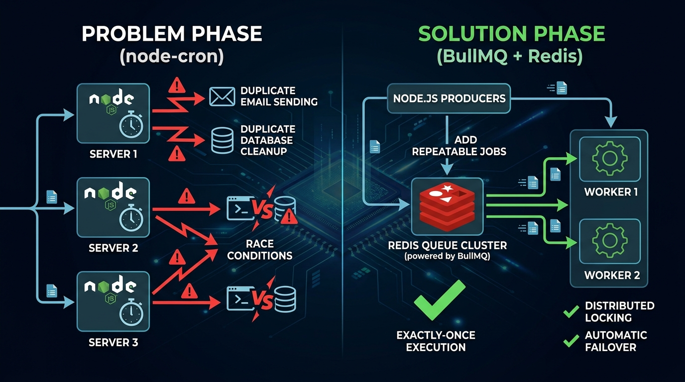
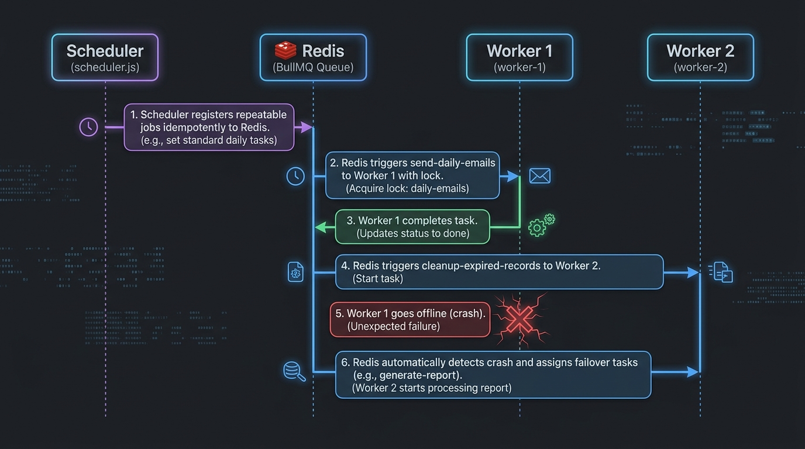
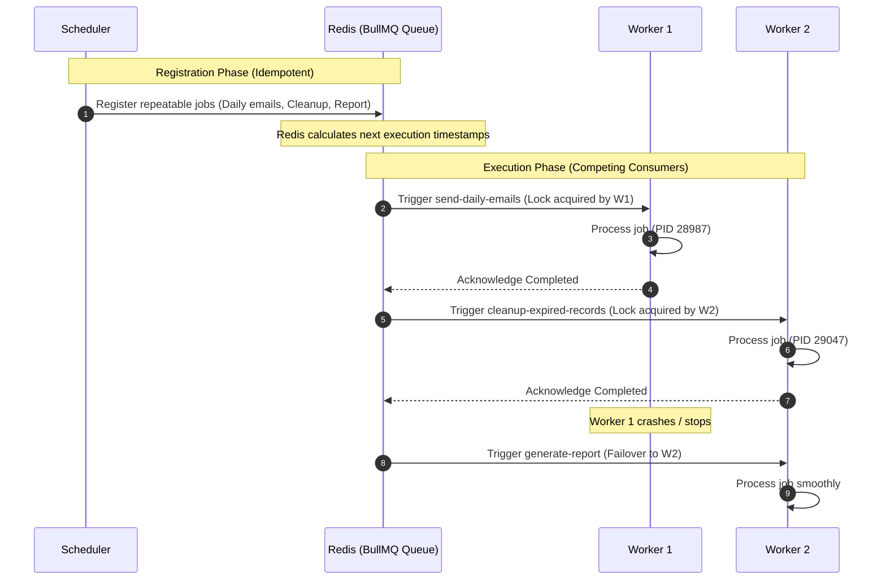

# 🚀 BullMQ Distributed Task & Cron Architecture

> **Complete migration from decentralized in-memory `node-cron` to centralized Redis-backed `BullMQ` for horizontally scaled environments.**

---

## 📌 Architecture Overview

When scaling horizontally across multiple server instances or containers, in-memory schedulers (`node-cron`) run concurrently on every instance, triggering duplicate tasks. 

**BullMQ with Redis solves this** by decoupling **scheduling** from **execution**:
1. Repeatable jobs are registered once in Redis with cron patterns.
2. Multiple worker instances compete for jobs using Redis atomic locks (`Redlock` / Lua scripts).
3. **Exactly one worker** executes each job instance, eliminating duplicates.



---

## 🏗️ System Workflow



### 🔄 Execution Flow Breakdown

```text
┌─────────────────────────┐       ┌────────────────────────┐       ┌────────────────────────┐
│  Scheduler (Node.js)    │       │   Redis (BullMQ Queue) │       │ Distributed Workers    │
└────────────┬────────────┘       └───────────┬────────────┘       └───────────┬────────────┘
             │                                │                                │
 1. Register │  upsertJobScheduler()          │                                │
    Jobs     ├───────────────────────────────>│ (Idempotent schedule stored)  │
             │                                │                                │
             │                                │ 2. Atomic Lock / Trigger       │
             │                                ├───────────────────────────────>│ Worker 1 (PID 28987)
             │                                │    send-daily-emails           │ -> Executes task
             │                                │<───────────────────────────────┤ -> Completed
             │                                │                                │
             │                                │ 3. Atomic Lock / Trigger       │
             │                                ├───────────────────────────────>│ Worker 2 (PID 29047)
             │                                │    cleanup-expired-records     │ -> Executes task
             │                                │<───────────────────────────────┤ -> Completed
             │                                │                                │
             │                                │ 💥 Worker 1 stops / crashes    │
             │                                │ 4. Automatic Failover          │
             │                                ├───────────────────────────────>│ Worker 2 (PID 29047)
             │                                │    generate-report             │ -> Takes over smoothly!
```

<details>
<summary><b>Click to expand raw Mermaid Sequence Diagram</b></summary>



</details>

---

## 📁 Project Structure

```
MIgratetoBullMq/
├── assets/
│   ├── architecture-diagram.png    # System visual architecture
│   └── workflow-diagram.png        # Sequence workflow visual diagram
├── .env                            # Environment variables (PORT, NUM_WORKERS, REDIS)
├── server.js                       # All-in-one runner: runs scheduler & spawns worker pool
├── redis.js                        # Centralized Redis connection configuration
├── queue.js                        # BullMQ Queue instance ('cron-jobs')
├── jobs.js                         # Job names, cron patterns, and task execution logic
├── scheduler.js                    # Registers repeatable jobs in Redis (Created/Skipped)
├── worker.js                       # Standalone worker process consuming tasks
├── package.json                    # Project dependencies & runner scripts
└── README.md                       # Implementation & verification guide
```

---

## 🧩 File Explanations

### 1. `.env` — Environment Configuration
Defines server port, instance ID, Redis connection, and number of workers to spawn inside the process:
```env
PORT=3000
INSTANCE_ID=server-1
REDIS_HOST=127.0.0.1
REDIS_PORT=6379
NUM_WORKERS=2
```

### 2. `server.js` — All-in-One Server Runner
Combines the entire system into a single cohesive process:
1. Loads `.env` configuration.
2. Synchronizes repeatable jobs using `scheduleJobs()` (creates new ones or skips existing ones).
3. Spawns `NUM_WORKERS` workers (e.g., `server-1-w1`, `server-1-w2`) running concurrently.
4. Starts an HTTP health-check server (`http://localhost:3000`).
5. Handles graceful shutdown (`SIGINT`/`SIGTERM`) cleanly terminating all workers and queue connections.

### 3. `redis.js` — Connection Configuration
Configures connection parameters for Redis. Uses `maxRetriesPerRequest: null` as required by BullMQ to allow blocking commands (`BRPOPLPUSH`) without request timeout errors.

### 4. `queue.js` — BullMQ Queue
Initializes the `cron-jobs` queue using the shared connection options. Both producers and schedulers interact with this queue.

### 5. `jobs.js` — Job Definitions & Task Handlers
Extracts the cron patterns from the original `server.js` into clean, declarative definitions:
- **`send-daily-emails`**: `*/10 * * * * *` (Every 10 seconds)
- **`cleanup-expired-records`**: `*/15 * * * * *` (Every 15 seconds)
- **`generate-report`**: `*/20 * * * * *` (Every 20 seconds)

### 6. `scheduler.js` — Repeatable Job Registration
Uses BullMQ's scheduler API (`upsertJobScheduler`) to register repeatable jobs in Redis. This script checks Redis first:
- Logs `🆕 Created` if registering for the first time.
- Logs `⏭️ Skipped` if the schedule already exists in Redis.

### 7. `worker.js` — Standalone Distributed Worker
Can be launched independently (`INSTANCE_ID=worker-1 npm run worker`) or managed automatically inside `server.js`. BullMQ guarantees atomic job locking so only one worker picks up each execution.

---

## 🚀 How to Run and Verify

### Step 1: Ensure Redis is Running
```bash
redis-cli ping
# Expected output: PONG
```

### Step 2: Register Repeatable Jobs
In your terminal, run the scheduler to register the cron patterns in Redis:
```bash
npm run scheduler
```

#### 🆕 First Run (Jobs Created):
```
====================================
Checking & Registering Jobs in BullMQ...
====================================
🆕 Created [send-daily-emails] with pattern: "*/10 * * * * *"
🆕 Created [cleanup-expired-records] with pattern: "*/15 * * * * *"
🆕 Created [generate-report] with pattern: "*/20 * * * * *"
====================================
Scheduler sync complete!
====================================
```

#### ⏭️ Subsequent Runs (Jobs Skipped if Already in Redis):
If you re-run `npm run scheduler` or start multiple instances:
```
====================================
Checking & Registering Jobs in BullMQ...
====================================
⏭️  Skipped [send-daily-emails] -> Already exists in Redis with pattern: "*/10 * * * * *"
⏭️  Skipped [cleanup-expired-records] -> Already exists in Redis with pattern: "*/15 * * * * *"
⏭️  Skipped [generate-report] -> Already exists in Redis with pattern: "*/20 * * * * *"
====================================
Scheduler sync complete!
====================================
```

---

### Step 3: Run Multiple Workers (Verify Exactly-Once Execution)

Open **two separate terminal windows** to simulate a multi-instance production environment:

#### Terminal 1 (Worker Instance 1):
```bash
INSTANCE_ID=worker-1 npm run worker
```

#### Terminal 2 (Worker Instance 2):
```bash
INSTANCE_ID=worker-2 npm run worker
```

---

### 📊 Real-World Verified Output: Zero Duplication & Competing Consumers

Here are the actual logs captured when running `worker-1` and `worker-2` concurrently:

#### Terminal 1 (`INSTANCE_ID=worker-1` | PID: 28987):
```log
====================================
Starting BullMQ Worker: worker-1
PID: 28987
Queue: cron-jobs
====================================
[worker-1] BullMQ Worker is ready and waiting for jobs...
[2026-10-01T08:57:30.070Z] [worker-1] PID=28987 (Job ID: repeat:scheduler-cleanup-expired-records:1790845050000) -> Executing: Cleanup expired records
[worker-1] Completed job cleanup-expired-records (ID: repeat:scheduler-cleanup-expired-records:1790845050000)
[2026-10-01T08:57:40.025Z] [worker-1] PID=28987 (Job ID: repeat:scheduler-generate-report:1790845060000) -> Executing: Generate report
[worker-1] Completed job generate-report (ID: repeat:scheduler-generate-report:1790845060000)
[2026-10-01T08:57:45.051Z] [worker-1] PID=28987 (Job ID: repeat:scheduler-cleanup-expired-records:1790845065000) -> Executing: Cleanup expired records
[worker-1] Completed job cleanup-expired-records (ID: repeat:scheduler-cleanup-expired-records:1790845065000)
[2026-10-01T08:58:00.036Z] [worker-1] PID=28987 (Job ID: repeat:scheduler-cleanup-expired-records:1790845080000) -> Executing: Cleanup expired records
[worker-1] Completed job cleanup-expired-records (ID: repeat:scheduler-cleanup-expired-records:1790845080000)
[2026-10-01T08:58:00.046Z] [worker-1] PID=28987 (Job ID: repeat:scheduler-send-daily-emails:1790845080000) -> Executing: Send daily emails
[worker-1] Completed job send-daily-emails (ID: repeat:scheduler-send-daily-emails:1790845080000)
^C
[worker-1] Received SIGINT. Shutting down worker gracefully...
[worker-1] Worker stopped cleanly.
```

#### Terminal 2 (`INSTANCE_ID=worker-2` | PID: 29047):
```log
====================================
Starting BullMQ Worker: worker-2
PID: 29047
Queue: cron-jobs
====================================
[worker-2] BullMQ Worker is ready and waiting for jobs...
[2026-10-01T08:57:30.108Z] [worker-2] PID=29047 (Job ID: repeat:scheduler-send-daily-emails:1790845050000) -> Executing: Send daily emails
[worker-2] Completed job send-daily-emails (ID: repeat:scheduler-send-daily-emails:1790845050000)
[2026-10-01T08:57:40.026Z] [worker-2] PID=29047 (Job ID: repeat:scheduler-send-daily-emails:1790845060000) -> Executing: Send daily emails
[worker-2] Completed job send-daily-emails (ID: repeat:scheduler-send-daily-emails:1790845060000)
[2026-10-01T08:57:50.081Z] [worker-2] PID=29047 (Job ID: repeat:scheduler-send-daily-emails:1790845070000) -> Executing: Send daily emails
[worker-2] Completed job send-daily-emails (ID: repeat:scheduler-send-daily-emails:1790845070000)
[2026-10-01T08:58:00.036Z] [worker-2] PID=29047 (Job ID: repeat:scheduler-generate-report:1790845080000) -> Executing: Generate report
[worker-2] Completed job generate-report (ID: repeat:scheduler-generate-report:1790845080000)
[2026-10-01T08:58:10.089Z] [worker-2] PID=29047 (Job ID: repeat:scheduler-send-daily-emails:1790845090000) -> Executing: Send daily emails
[worker-2] Completed job send-daily-emails (ID: repeat:scheduler-send-daily-emails:1790845090000)
[2026-10-01T08:58:15.013Z] [worker-2] PID=29047 (Job ID: repeat:scheduler-cleanup-expired-records:1790845095000) -> Executing: Cleanup expired records
[worker-2] Completed job cleanup-expired-records (ID: repeat:scheduler-cleanup-expired-records:1790845095000)
[2026-10-01T08:58:20.044Z] [worker-2] PID=29047 (Job ID: repeat:scheduler-generate-report:1790845100000) -> Executing: Generate report
[worker-2] Completed job generate-report (ID: repeat:scheduler-generate-report:1790845100000)
[2026-10-01T08:58:20.048Z] [worker-2] PID=29047 (Job ID: repeat:scheduler-send-daily-emails:1790845100000) -> Executing: Send daily emails
[worker-2] Completed job send-daily-emails (ID: repeat:scheduler-send-daily-emails:1790845100000)
[2026-10-01T08:58:30.099Z] [worker-2] PID=29047 (Job ID: repeat:scheduler-cleanup-expired-records:1790845110000) -> Executing: Cleanup expired records
[worker-2] Completed job cleanup-expired-records (ID: repeat:scheduler-cleanup-expired-records:1790845110000)
[2026-10-01T08:58:30.103Z] [worker-2] PID=29047 (Job ID: repeat:scheduler-send-daily-emails:1790845110000) -> Executing: Send daily emails
[worker-2] Completed job send-daily-emails (ID: repeat:scheduler-send-daily-emails:1790845110000)
```

---

### 🔍 Key Proofs Confirmed by This Test:

1. **Exactly-Once Execution Across All Jobs:**
   - Look at `08:57:30`: `worker-1` handled `cleanup-expired-records` while `worker-2` handled `send-daily-emails`. **Neither task was duplicated**.
   - Look at `08:57:40`: `worker-1` handled `generate-report` while `worker-2` handled `send-daily-emails`.
2. **Workload Balancing (Competing Consumers):**
   - The workload was distributed automatically between both processes based on worker availability.
3. **Resilient Failover:**
   - When `worker-1` was killed (`SIGINT`) after `08:58:00`, `worker-2` immediately and seamlessly processed the subsequent ticks (`08:58:10`, `08:58:15`, `08:58:20`, `08:58:30`) without a single missed task!

---

### Step 4: Verify Failover (High Availability)

1. While both workers are running, stop **Worker 1** with `Ctrl + C`.
2. Observe **Worker 2** in the remaining terminal.
3. When the next interval triggers, **Worker 2 automatically picks up all scheduled jobs** without any downtime or missed executions.

---

## 🏆 Key Benefits Summary

| Feature | `node-cron` | BullMQ + Redis |
| :--- | :--- | :--- |
| **Multi-Instance Safety** | ❌ Duplicate executions on every node | ✅ Guaranteed single execution per schedule |
| **Horizontal Scaling** | ❌ Multiplies work load dangerously | ✅ Distributes load evenly across workers |
| **High Availability** | ❌ If server crashes, job is lost | ✅ Survives crashes; other workers take over |
| **Retries & Backoff** | ❌ None (must implement manually) | ✅ Configurable exponential retries built-in |
| **Observability** | ❌ Console logs only | ✅ Real-time metrics, Bull-Board dashboard UI |
