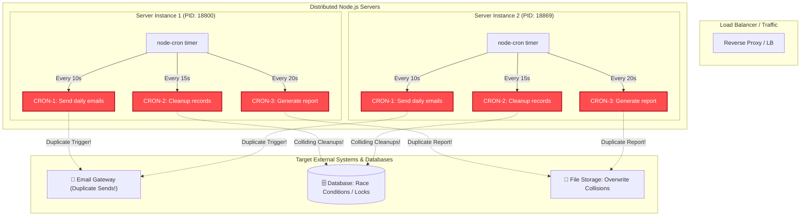
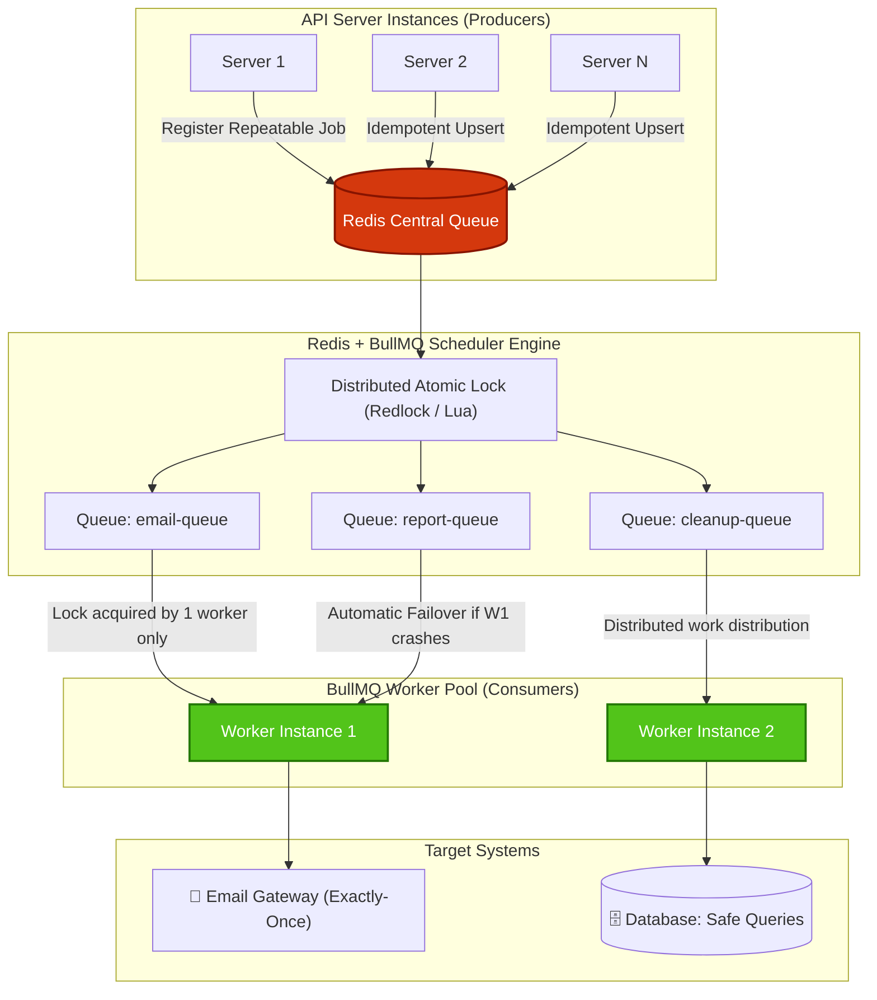

# 🔄 Cron to BullMQ Migration

> **Centralizing Scheduled Tasks & Eliminating Duplicate Executions in Horizontally Scaled Node.js Applications**

---

## 📌 Executive Summary

| Attribute | Current State (Problem Phase) | Target State (Solution Phase) |
| :--- | :--- | :--- |
| **Scheduling Engine** | `node-cron` (In-Memory per Node process) | `BullMQ` + `Redis` (Centralized Distributed Queue) |
| **Execution Model** | Decentralized; runs on **every** server instance | Centralized; distributed across worker pool |
| **Concurrency** | $N$ duplicate executions for $N$ server replicas | **Exactly-once** execution across the cluster |
| **Fault Tolerance** | No failover; jobs die with instance crashes | Automatic retries, stall detection, and failover |
| **Scalability** | Horizontally scaling servers multiplies job runs | Horizontally scaling adds worker throughput safely |

---

## 🎯 Purpose

Migrate existing scheduled cron jobs and queues to **Redis BullMQ** to achieve reliable, fault-tolerant, and centralized task processing across multi-instance production environments.

---

## ⚠️ The Problem: Horizontal Scaling Breakdown

Currently, cron jobs are scheduled in-process using `node-cron` inside `server.js`. When the application runs on a single server, jobs execute normally. However, modern production architectures deploy multiple replicas (e.g., Kubernetes pods, AWS ECS tasks, PM2 cluster mode) behind a load balancer.

### What Happens When Scaling Out:
1. **Duplicate Executions:** Each instance initializes its own independent timer loop. When the scheduled time arrives, **every** instance triggers the same job simultaneously.
2. **Resource Exhaustion & Race Conditions:** Critical operations (e.g., daily emails, payment reconciliation, report generation, database purges) collide, leading to data corruption, rate limits, and duplicate customer communications.
3. **No Failover or Crash Recovery:** If an instance crashes midway through executing a heavy task, the job is lost with no built-in retry mechanism or visibility.

---

## 🖼️ Architectural Comparison


---

### Detailed Architecture Diagrams

#### 1. Problem Architecture (Current `node-cron` Setup)
Each server runs an isolated timer loop in Node.js event-loop memory without shared state:



---

#### 2. Target Architecture (BullMQ + Redis Centralized Queue)
Repeatable jobs are registered centrally in Redis. BullMQ workers acquire atomic locks so that exactly one worker processes each execution:



---

## 🧪 Real-World Evidence: Reproducing the Problem

When running two independent instances of `server.js` simultaneously:

```bash
# Terminal 1
INSTANCE_ID=server-1 PORT=3001 npm start

# Terminal 2
INSTANCE_ID=server-2 PORT=3002 npm start
```

### Observed Terminal Log Output:
```log
====================================
Starting server-1 (Port: 3001)
====================================
[2026-10-01T07:24:30.006Z] [server-1] PID=18800 CRON-1 -> Send daily emails
[2026-10-01T07:24:30.005Z] [server-1] PID=18800 CRON-2 -> Cleanup expired records
[2026-10-01T07:24:40.008Z] [server-1] PID=18800 CRON-1 -> Send daily emails
[2026-10-01T07:24:40.007Z] [server-1] PID=18800 CRON-3 -> Generate report

====================================
Starting server-2 (Port: 3002)
====================================
[2026-10-01T07:24:30.010Z] [server-2] PID=18869 CRON-1 -> Send daily emails
[2026-10-01T07:24:30.012Z] [server-2] PID=18869 CRON-2 -> Cleanup expired records
[2026-10-01T07:24:40.003Z] [server-2] PID=18869 CRON-1 -> Send daily emails
[2026-10-01T07:24:40.002Z] [server-2] PID=18869 CRON-3 -> Generate report
```

> ⚠️ **Key Takeaway:** At `07:24:30.006Z` and `07:24:30.010Z` (within 4 milliseconds of each other), **both server-1 and server-2 triggered `CRON-1` and `CRON-2` simultaneously**. In production, users would receive duplicate emails and batch database procedures would collide.

---

## 🛠️ The Solution: BullMQ with Redis

By migrating to BullMQ, task scheduling moves from local process memory to a persistent, distributed Redis store:

1. **Repeatable Jobs (Cron Scheduling in Redis):**
   BullMQ schedules repeatable jobs using cron syntax (`pattern: '*/10 * * * * *'`). Redis keeps track of the next execution timestamp.
2. **Distributed Atomic Locking:**
   Even if 10 server instances start up and register the same repeatable job with the same `jobId`, BullMQ deduplicates the schedule idempotently.
3. **Competing Consumer Pattern:**
   Only one worker from the pool grabs and locks the job when the timer fires.
4. **Stall Detection & Crash Recovery:**
   If a worker process dies while handling a job, BullMQ detects the stalled lock and reassigns the job to an active worker.

---

## 📋 MVP Scope & Implementation Roadmap

- [ ] **Step 1: Redis & BullMQ Infrastructure**
  - Configure Redis connection via `ioredis`.
  - Establish a shared connection configuration.
- [ ] **Step 2: Queue & Worker Setup**
  - Initialize a task Queue (`email-queue`).
  - Create a dedicated Worker to process tasks asynchronously.
- [ ] **Step 3: Migrate a Proof-of-Concept Task**
  - Migrate `CRON-1` (Send daily emails) to a BullMQ repeatable job.
  - Implement idempotent job scheduling via `upsertJobScheduler`.
- [ ] **Step 4: Concurrency Verification**
  - Launch `server-1` (Port 3001) and `server-2` (Port 3002).
  - Confirm that `CRON-1` fires **exactly once** across both instances.
- [ ] **Step 5: Failover & Resilience Verification**
  - Force kill (`SIGKILL`) an instance while it processes a task.
  - Confirm that the second instance picks up and completes pending/stalled jobs.
